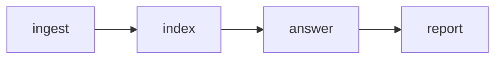

# SEC EDGAR Filing Radar


A daily Airflow pipeline that downloads new SEC 8-K filings for a watchlist of companies, indexes them in a vector database, and uses retrieval-augmented generation (RAG) to answer a fixed set of questions about them. The result is a Markdown report with sources.

Built as a small, readable example of how Airflow, a vector store and an LLM fit together. The whole pipeline lives in one file.

## How it works



| Task | What it does | Output |
| --- | --- | --- |
| `ingest` | Reads each company's filing history from the EDGAR API, downloads new 8-K filings (main document plus exhibit 99.1) and strips them down to plain text | `data/filings/*.json` |
| `index` | Splits each filing into overlapping chunks and stores them in ChromaDB with their metadata | `data/chroma/` |
| `answer` | For every company and question, retrieves the most relevant chunks and asks the LLM to answer using only those excerpts | `data/answers/<date>.json` |
| `report` | Formats the answers and their sources as Markdown | `reports/<date>.md` |

Tasks pass file paths to each other, never the documents themselves, so any step can be re-run on its own. `ingest` skips filings it already has and `index` upserts by a stable ID, so re-running the DAG does not duplicate data.

## Stack

- [Apache Airflow](https://airflow.apache.org/) 3 with the TaskFlow API
- [SEC EDGAR APIs](https://www.sec.gov/search-filings/edgar-application-programming-interfaces), free and without an API key
- [ChromaDB](https://www.trychroma.com/) in local persistent mode, with its built-in `all-MiniLM-L6-v2` embeddings
- [Groq](https://console.groq.com/) for the LLM, through its OpenAI-compatible endpoint
- BeautifulSoup for HTML cleaning

## Setup

Tested on Linux with Python 3.14. Airflow does not run natively on Windows; use WSL2 there.

```bash
git clone https://github.com/<your-user>/sec-edgar-filing-radar.git
cd sec-edgar-filing-radar

python3 -m venv .filing-radar-venv
source .filing-radar-venv/bin/activate
pip install apache-airflow chromadb beautifulsoup4
```

Set two environment variables. Adding them to the end of `.filing-radar-venv/bin/activate` makes them load with the environment:

```bash
export AIRFLOW_HOME=/absolute/path/to/sec-edgar-filing-radar/airflow
export GROQ_API_KEY="your-key-here"
```

`AIRFLOW_HOME` keeps Airflow's database and logs inside the project folder. A Groq API key can be created for free in the [Groq console](https://console.groq.com/).

Finally, open `airflow/dags/filing_radar.py` and put your name and email in `HEADERS`. The SEC requires automated clients to identify themselves and rejects requests without a descriptive `User-Agent`.

## Running it

### With the Airflow UI

```bash
airflow standalone
```

Open `http://localhost:8080` and log in as `admin` with the password printed in the terminal. Enable the `filing_radar` DAG and trigger it. It is also scheduled to run on weekdays at 07:00 UTC while Airflow is up.

### From the terminal

```bash
python airflow/dags/filing_radar.py
```

This runs all four tasks in a single process without the scheduler, which is handy for debugging.

### Reading the report

```bash
cat reports/*.md
```

Example excerpt:

```markdown
## AAPL

### What were the most recent quarterly financial results?

Apple's most recent filing reports the fiscal 2026 third-quarter results (ended June 27).
The company posted revenue of $109.4 billion, a 16% increase year over year, and diluted
earnings per share of $2.02.

Sources:

- https://www.sec.gov/Archives/edgar/data/320193/000032019326000018/0000320193-26-000018-index.htm
```

## Configuration

Everything is a constant at the top of `airflow/dags/filing_radar.py`:

| Constant | Purpose |
| --- | --- |
| `COMPANIES` | Watchlist, as ticker to CIK. Look up a CIK with the [SEC company search](https://www.sec.gov/search-filings/cik-lookup) |
| `LOOKBACK_DAYS` | How far back to look for filings |
| `QUESTIONS` | Questions asked about every company |
| `TOP_K` | Number of chunks retrieved per question |
| `LLM_URL`, `LLM_MODEL` | Any OpenAI-compatible chat endpoint and model |
| `SYSTEM_PROMPT` | Instructions that keep answers grounded in the excerpts |

## Inspecting retrieval

`query_chroma.py` shows which chunks a question retrieves, without calling the LLM. Useful for tuning the questions:

```bash
python query_chroma.py "Who joined the board?"
```

## Project structure

```
sec-edgar-filing-radar/
├── airflow/
│   └── dags/
│       └── filing_radar.py   # the whole pipeline
├── query_chroma.py           # retrieval debugging helper
├── data/                     # generated, not versioned
│   ├── filings/
│   ├── chroma/
│   └── answers/
└── reports/                  # generated Markdown reports
```

## Limitations and ideas

- Chunking is a fixed-size character window that ignores paragraph and table boundaries. Financial tables come out as loose numbers.
- Answers cover everything in the index, not only the filings added in the current run.
- Only 8-K filings are ingested. 10-K and 10-Q filings are much longer and would benefit from section-aware chunking.
- Broad questions tend to retrieve boilerplate. Specific questions work better.
- Answers are generated by a language model and can be wrong. Check the linked source before relying on a figure.

## Disclaimer

This is a learning project and not investment advice. Filing data comes from the SEC's public EDGAR system. Keep request rates within the SEC's [fair access guidelines](https://www.sec.gov/os/webmaster-faq#developers).
